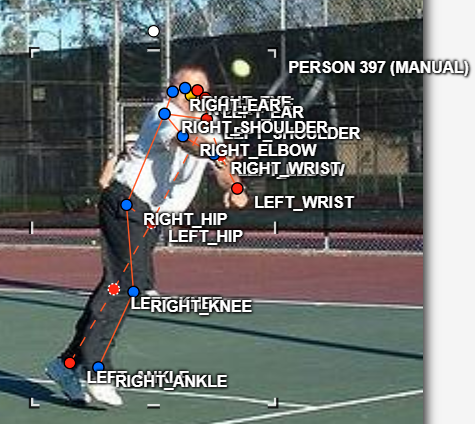
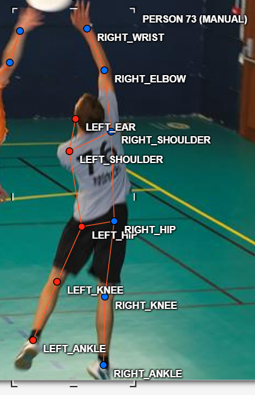
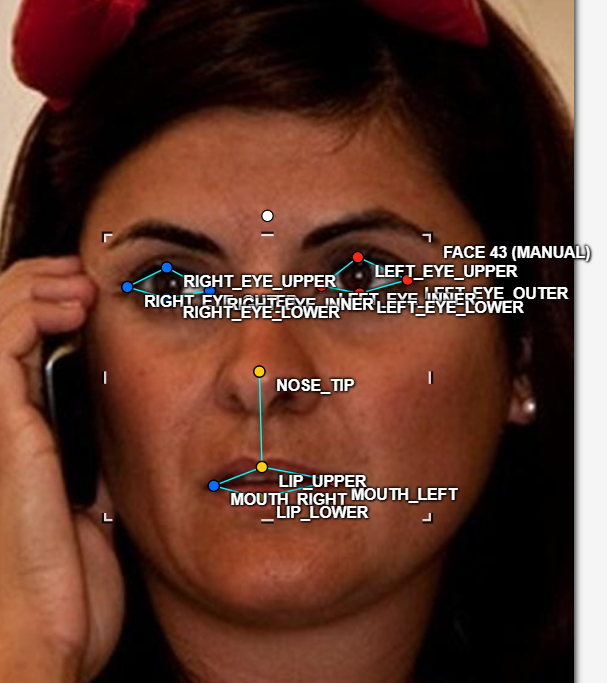
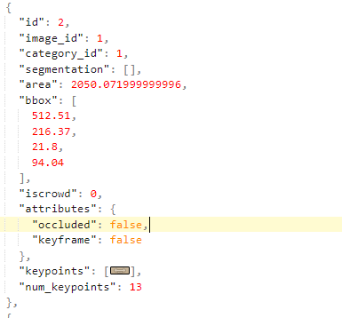

# Báo cáo cá nhân — NguyenVietQuan-2A202603035

Đổi tên file theo quy tắc `MSSV_HoTen.md`. Ví dụ: `20241234_NguyenVanAn.md`.

Dữ liệu: 12 ảnh người COCO val2017 (Lin et al., 2014) và 8 ảnh chân dung Wikimedia Commons, chỉ dùng trong lớp.

## 0. Thông tin học viên

- Họ tên: Nguyễn Việt Quân
- MSSV: 2A202603035
- Email: 26ai.quannv3@vinuni.edu.vn
- Link repository: https://github.com/JakeNguyen99/K5-L2-DAY04-NguyenVietQuan-2A202603035-KeypointPose
- Phiên bản CVAT (Help → About): 2.74.1
- Máy: hệ điều hành Window 10 · RAM 16gb GB · chạy CVAT chế độ đầy đủ
- Bộ ảnh (`src/exports/assignment.json` do `lab.py setup` tạo): có / không
- Giờ bắt đầu: 17:00 12/11/2026
- Giờ kết thúc: 9:00 13/11/2026

## 1. Kiểm tra label (CP0)

| Label | Kiểu | Số điểm | Tên điểm đúng bảng của lab? | Đúng thứ tự? | Số cạnh |
|---|---|---:|---|---|---:|
| `person` | Skeleton| 17| Đúng| Đúng| 19|
| `face` | Skeletion| 13| Đúng| Đúng|13 |

Mẫu `person` dựng theo người quay mặt về camera (các điểm `left_*` nằm bên phải khung mẫu)? Có

Cách đổi cờ `occluded` / `outside` cho **một điểm** trên phiên bản CVAT này (một câu): Dùng con trỏ chuột trỏ vào điểm đó và nhấp phím q hoặc o để đổi cờ `occluded` hoặc `outside`

...

## 2. Số lượng đã gán và thời gian (CP1, CP2)

| Nhóm ảnh | Số ảnh | Số skeleton đã gán | Số người dưới 60 px (không gán) | Số poster / gương / màn hình bỏ qua | Thời gian (phút) |
|---|---:|---:|---:|---:|---:|
| `easy` | 5 | 5| 0| 0| |
| `occluded` | 3 | 4| 0| 0| |
| `back` | 2| 3| 1| 0| |
| `small` | 1 | 1| 2| 0| |
| `crowd` | 1 | 3| 0| 0| |
| `faces` | 8 | 8| 0| 0| |

- Số ảnh người đã xong ở mốc phút 105:  10 / 10
- Thời gian thực tế (phút): CP1 ___ · CP2 ___ · CP3 ___
- Ảnh tốn thời gian nhất là ảnh nào, vì sao?
000000326480.jpg tốn nhiều thời gian nhất, bởi ảnh có 3 người đứng gom lại với nhau nên phải gán skeleton thật kỹ.
...

## 3. Bảng ca khó (CP1, CP2)

Mỗi điểm bạn phân vân một dòng, nhất là phân vân giữa `v = 1` và `v = 0`, hoặc không chắc hướng người.

| Ảnh | Người / mặt | Điểm | Cờ đã chọn | Phân vân giữa | Lý do chọn |
|---|---|---|---:|---|---|
| 000000326480.jpg | Người | 199 RIGHT_ELBOW | `v = 0` | phân vân giữa `v = 1` và `v = 0`| Không ước lượng được vị trí RIGHT_ELBOW |
| 000000326480.jpg |  Người |  199 RIGHT_WRIST | `v = 0` | phân vân giữa `v = 1` và `v = 0`| Không ước lượng được vị trí RIGHT_WRIST |
| 000000393909.jpg | Người | 307 RIGHT_HIP | `v = 0` | phân vân giữa `v = 1` và `v = 0` | Không ước lượng được vị trí RIGHT_HIP|

## 4. Bảng tự review (CP3)

Đi từ ảnh cuối về ảnh đầu. 5 ảnh người (ít nhất 2 ảnh `back` hoặc `crowd`) và 3 ảnh mặt. Ít nhất 8 dòng, kể cả dòng `ok`. Ghi lỗi trước, sửa sau.

Mã lỗi dùng đúng một trong: `lr_swap`, `vis_flag`, `position`, `missing`, `extra`, `ok`.

| Ảnh | Người / mặt | Điểm | Mã lỗi | Ghi chú | Đã sửa? |
|---|---|---|---|---|---|
| 000000508269.jpg | Người | | extra | gán skeleton cho người thấp hơn 60px | Đã sửa |
| 000000393909.jpg | Người | 307 LEFT_KNEE | vis_flag | đầu gối bị khuất | Đã sửa |
| 000000391222.jpg | Người | 271 RIGHT_KNEE | vis_flag | đầu gối bị khuất | Đã sửa |
| 000000211458.jpg | Người | 145 RIGHT_SHOULDER | vis_flag | vai phải bị khuất | Đã sửa|
| 000000326480.jpg | Người | | extra | gán skeleton cho người thấp hơn 60px | Đã sửa |
| face_575921.jpg | Mặt| | Ok | | |
| face_556064.jpg | Mặt | | Ok| | |
| face_53580.jpg | Mặt | | Ok| | |

Tổng hợp số lỗi theo mã:

| `lr_swap` | `vis_flag` | `position` | `missing` | `extra` | `ok` |
|---:|---:|---:|---:|---:|---:|
|0 | 3| 0| 0| 2| 3|

Điểm còn phân vân giữa `v = 1` và `v = 0` (ghi cả hai lựa chọn và lý do chọn):

...

## 5. Kiểm file xuất và kết quả tự kiểm (CP4)

Tự kiểm tay trong file JSON:

| File | Người / mặt kiểm (ảnh, thứ tự) | Số phần tử `keypoints` | Điểm `outside` ra `v = 0`, `occluded` ra `v = 1`? | `num_keypoints` khớp? |
|---|---|---:|---|---|
| `HoVaTen_persons.zip` | 12 ảnh| 256 | `v = 0`: 75, `v = 1`: 36 | |
| `HoVaTen_faces.zip` | 8 ảnh| 96 | `v = 0`: 8, `v = 1`: 3 | |

Sau khi xuất, CVAT ghi `occluded` thành `v = 1` và `outside` thành `v = 0`. Tọa độ của điểm `outside` trong file là `0, 0`

Hai job đã chuyển sang completed trên CVAT? Có

Dán phần **TÓM TẮT** in ra từ `src/check_submission.py`:

```text
- File person: NguyenVietQuan_persons.zip
  Số ảnh: 12 · số skeleton `person`: 20 · mỗi annotation 51 số
  Skeleton theo ảnh: 000000106051=2, 000000163118=2, 000000177889=1, 000000184224=1, 000000211458=1, 000000225138=1, 000000326480=3, 000000391222=2, 000000393909=2, 000000467300=2, 000000469061=2, 000000508269=1
  Cờ v: v=2 229 (67%) · v=1 36 (11%) · v=0 75 (22%)
  num_keypoints trung bình: 13.2
- File face: NguyenVietQuan_faces.zip
  Số ảnh: 8 · số skeleton `face`: 8 · mỗi annotation 39 số
  Skeleton theo ảnh: face_105668=1, face_155465=1, face_296767=1, face_38721=1, face_425647=1, face_53580=1, face_556064=1, face_575921=1
  Cờ v: v=2 93 (89%) · v=1 3 (3%) · v=0 8 (8%)
  num_keypoints trung bình: 12.0
- Ghi chú: 83 điểm v = 0 vẫn mang tọa độ cũ (CVAT 2.x xuất như vậy; chuẩn COCO ghi 0, 0). Không phải lỗi: điểm v = 0 bị bỏ qua khi huấn luyện và khi chấm.
- Số [LỖI]: 0 · số [CẢNH BÁO]: 2
Kết quả: ĐẠT (đọc lại từng cảnh báo ở trên)
```

Các `[CẢNH BÁO]` còn giữ nguyên và lý do: các `[CẢNH BÁO]` còn giữ nguyên là các cảnh báo đã kiểm tra lại 

...

## 6. Ảnh chụp màn hình

1. Label `person` trong label constructor (đủ 17 điểm có tên):

   

2. Một người quay lưng đã gán, cờ đã đặt:

   

3. Một khuôn mặt đã gán 13 điểm, phóng to vùng mắt:

   

4. Một đoạn JSON xuất của một người:

   

Nguồn ảnh: COCO val2017 / Wikimedia Commons.

## 7. Tự đánh giá

1. Lỗi bạn mắc nhiều nhất hôm nay, và cách bạn sẽ tránh ở dự án thật:
Lỗi mắc nhiều nhất là vis_flag (3 lần), cụ thể là đặt sai cờ cho các điểm bị khuất như đầu gối và vai, và lỗi extra (2 lần) do gán skeleton cho người thấp hơn 60 px. Em sẽ rút kinh nghiệm để không lặp lại ở dự án thật
   ...

2. Một quy tắc bạn đề xuất thêm vào guideline (kèm ảnh ví dụ nếu có):

   ...

3. Nhãn của bạn đi vào model ở đâu? Chọn một lỗi bạn đã sửa và nói nó sẽ làm model học sai thế nào (heatmap, trọng số trong loss, hay bước lật ảnh):

   ...

## 8. Khó khăn và lỗi kỹ thuật

...

## Bonus (nếu làm)

### B1 — 3 ảnh người khó thêm

| Ảnh | Số skeleton | Số người dưới 60 px | Ca khó nhất |
|---|---:|---:|---|
| 000000005294.jpg | 3 | 0 | gán skeleton cho người trong cùng bị che bởi tờ báo |
| 000000104800.jpg | 3 | 0 | gán skeleton cho người bị khuất một nửa sau mép ảnh|
| 000000254060.jpg| 2 | 0 | gán skeleton cho người ngồi phía sau |

Kết quả `src/check_submission.py` cho `HoVaTen_bonus_persons.zip`:

```text
- File person: NguyenVietQuan_bonus_persons.zip
  Số ảnh: 3 · số skeleton `person`: 8 · mỗi annotation 51 số
  Skeleton theo ảnh: 000000005294=3, 000000104800=3, 000000254060=2
  Cờ v: v=2 70 (51%) · v=1 19 (14%) · v=0 47 (35%)
  num_keypoints trung bình: 11.1
- Ghi chú: 47 điểm v = 0 vẫn mang tọa độ cũ (CVAT 2.x xuất như vậy; chuẩn COCO ghi 0, 0). Không phải lỗi: điểm v = 0 bị bỏ qua khi huấn luyện và khi chấm.
- Số [LỖI]: 0 · số [CẢNH BÁO]: 3
Kết quả: ĐẠT (đọc lại từng cảnh báo ở trên)
```

### B2 — 5 ảnh khuôn mặt đen trắng / hồng ngoại

Ảnh không màu khó hơn ở điểm nào? Kính râm trên ảnh hồng ngoại có còn là `v = 1` không?
Ảnh không màu khó hơn ở điểm Độ tương phản thấp và hiện tượng bết màu. Kính râm trên ảnh hồng ngoại có còn là `v = 1` thì tùy vào đặc tính của kính râm đó, nếu ảnh kính râm trong suốt thì `v = 2` còn không thì `v = 1`.
...

### B3 — Model so với nhãn của tôi (không tính điểm)

- Demo đã dùng:
- Ảnh đã thử:

1. Model có trả điểm cho khớp bị che, hay khớp ngoài ảnh không? Confidence ở các điểm đó thế nào?

   ...

2. Với người quay lưng, model có đổi trái/phải không?

   ...

3. Bộ điểm của model có giống 17 điểm COCO không?

   ...

## 9. Tài liệu tham khảo và công cụ AI đã dùng

...
